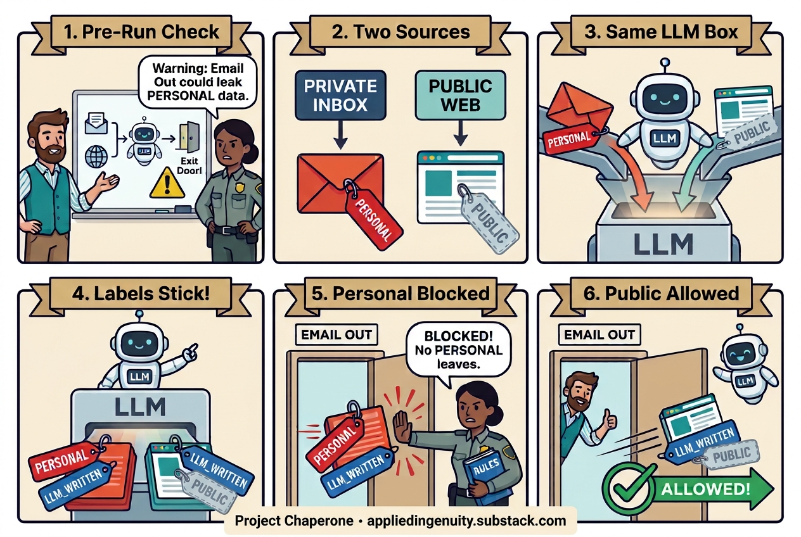

# Project Chaperone

Project Chaperone is a harness that allows agentic AI tool calling, while enforcing high-level policies such as
"no personal data may be leave the network". It adds two capabilities:

1. **audit report before running** will check every route of all workflows for violations of the rules. A human
makes policy decisions about exceptions to the rules, and those approvals are recorded. They can make these
decisions via the 'shape' of the policies needed, without worrying about the actual workflow details. (I.e. "Is it
reasonable that this workflow wants to write personal details to my calendar?")
2. **Enforcement at runtime** happens through data labels (`UNTRUSTED`, `PERSONAL`, ...) and module/tool properties
 (`OUTPUT`, `LEAVES_NETWORK`, ...). All calls are subject to the rules (minus acknowledged exceptions) at runtime.
A possible violation that is not worth designing away can be accepted as a risk: the call stays forbidden, and is
refused if a run attempts it.



*Cartoon: The main idea behind Project Chaperone, simplified to a single rule: PERSONAL data may not leave by e-mail.
Labels stick with the data as it passes through the LLM, and the harness blocks the call that would break the rule.*

[Project Chaperone](**LINK**) fixes the problems of "Agents with tools" (flexible, but a prompt cannot enforce a rule)
and hard-coded workflows (can be analyzed, but the analysis is manual and is often never done.) 
In Project Chaperone, that analysis is automated, and the rules are enforced while the system runs.

This repo ships with five shared rules (in [examples/rules/default.yaml](examples/rules/default.yaml)):
no destructive actions, nothing leaves the network,
no personal or untrusted data output, and no decision made from untrusted data (such as text an LLM wrote.) Each
project adds a few explicit exceptions. An LLM is optional: a module may call one, and a state may let an LLM choose the
next state in the workflow.

This repo also ships with these examples (some mentioned in the paper). The idea is to demonstrate how a workflow
can ask for small, scoped exceptions to the shared rules:

- **deliveries** - Intelligently add delivery notices from your mail into your calendar.
- **share_notes** - A minimal example showing a problematic workflow.
- **ask_my_mail** - An example of LLM interating with email
- **safe_rag** - Ask questions about the Federalist Papers, or your own documents.

## Install

Do the following one-time setup:

```
git clone https://github.com/AppliedIngenuity-ai/project-chaperone.git
cd project-chaperone
# Set up your virtual environment here (see below)
pip install -e .
# (Optional): also install test libraries
pip install -e ".[test]"
```

There are many different ways to setup Python virtual environments, this repo is agnostic.
One example using [venv](https://docs.python.org/3/tutorial/venv.html)) could be: run
`python -m venv .env` once, and `source .env/bin/activate` once per shell in which you will run
the commands below. Note that `pyproject.toml` asks for 3.13 or newer, and versions before 3.13.5
have not been tested.

Check the install:

```
python -m pytest
```

Note that tests 2 are skipped because they would ask a real LLM server (see "Step 1: your LLM" below).

## Run an example

From the folder `project-chaperone`:

```
python -m chaperone run examples/deliveries
```

1. You will see a `WARNING` about the `mail.send.*` module not being properly configured to send mail. This can be
   ignored. In fact, the code to send email is not written yet anyway.
2. The startup audit will run, and ask you about any exceptions (to the [5 default rules](examples/rules/default.yaml))
   that the project is requesting (via [examples/deliveries/exceptions.yaml]`examples/deliveries/exceptions.yaml`.)
   Because this is an example, you can type `1` at each prompt. At the end, you are asked for a name (just for you
   to remember why you approved it). That named list of approved exceptions are added to
   `state/deliveries/demo/accepted.json`, so identical questions won't be asked again. Note that these approvals are
   scoped per example, so "this is OK for package tracking" doesn't accidentally create loopholes for unrelated workflows.
   WARNING: In a real system, you would want to examine the details think carefully about the implications before
   allowing an exception.
3. A local web server is started, printing it's address in the form `http://127.0.0.1:<port>/?token=<token>`.
   Open that link in a browser (must be running on the same machine.)
4. On that web page, you will see a chat area on the left, and a list of workflows the right. Press 'Start'
   beside the `assistant` workflow, and the workflow's output will appear in the chat area. Type anything you want
   at each question. In the `demo` configuration, we have replaced the calls to LLM with a script that requests
   pre-defined tool calls: It will search the mail, ask for addresses (you can type any address), then finish.
   The workflow then allows you to approve (via checkboxes) any senders it found.
5. Next, press 'Start' beside `update_calendar` to kick off this workflow.  The conversation shows each made-up
   message as it is read, and each entry's values. One message is set aside on purpose: it gives no date.
   [The README](examples/deliveries/README.md) details each step.
4. Hit Ctrl-C to stop the harness web server.

You can kick off multiple workflows at once, and they are interleaved in the chat output.

Future runs won't re-ask about the exceptions you approved -- until you change the rules, exceptions, workflows,
or module labels/properties: In this case, the startup audit may ask for new approvals.

All workflow state is stored in `state/deliveries/demo/` (or more generally `state/<project>/<setup>/`).
You can delete this folder to forget *everything* the workflow has saved locally. You can also do this via
the web UI: on the State tab, there is a "Start from nothing" button. Note that deleting this folder is
generally only recommended for demo data.

You can pass in a `--setup` argument to switch between diffrent configurations: The default of `--setup demo`,
uses made-up data, and fake tool calls. (i.e. It doesn't talk to a real mail server or LLM). All of it's
state is in the folder `state/deliveries/demo`, and you can easily start over by deleting that folder.

You can pass in `--setup demo_llm` to pass the fake emails to a real LLM. (See configuration below)

Alternately, you can use `--setup real` to try it on your real calendars, email and LLM. (These must be configured,
see "Use your own LLM, mail and calendar" below.)  In this configuration you should avoid deleting your entire
state folder, because will create a second calendar.  You can use the `reset_all` workflow instead,
which clears out most state, except for the stateful parts needet to find the calendar.

See [docs/exceptions.md](docs/exceptions.md) to learn about exceptions and acknowledgements.

## The examples

See the ReadMe of each example for more detail. Also see "Project layout" (below) for how the files are organized.

### deliveries

Delivery notices from your mail, written to a calendar. An LLM chooses the next step of a conversation; addresses,
ticks and approvals are made in boxes the LLM is not passed.

- Try it: `python -m chaperone run examples/deliveries` (See also "Run an example" above)
- Setups: `demo`, `demo_llm`, `real_mail`, `real` (see "Use your own LLM, mail and calendar", below).
- Workflows: `assistant`, a conversation that chooses whose mail is monitored; `discover_links`, which finds the forms
  of those senders' tracking links and asks which to use; `update_calendar`, which reads their new mail and writes
  the calendar; `reset_entries`, which removes the entries and keeps the senders; `reset_all`, which removes
  everything stored.
- Also: `prompts.yaml` (the LLM's prompts), `modules/` (one file per tool), `demo/` (the made-up mail, LLM answers and
  calendar).
- [README](examples/deliveries/README.md).

### share_notes

The smallest: a note, an LLM's summary of it, shown to you, then e-mailed. The start reports the e-mail as a possible
violation of rules 3 and 5: answer `4` to each (an acknowledged risk), and the run refuses the e-mail when it is made.

- Try it: `python -m chaperone run examples/share_notes`
- Setup: `demo` (made-up answers, from `demo/`).
- Workflow: `share_summary`: summarizes a note, shows the summary, then tries to send it by e-mail.
- [Its README](examples/share_notes/README.md).

### ask_my_mail

A keyword and a question about your mail; the LLM's answer shown with its labels.

- Try it: `python -m chaperone run examples/ask_my_mail`
- Setup: `demo` (made-up mail and answers, from `demo/`).
- Workflow: `ask_my_mail`: searches the mail for the keyword, passes the messages and the question to the LLM, shows
  the answer.
- [Its README](examples/ask_my_mail/README.md).

### safe_rag

Questions about the Federalist Papers, or your own documents. An answer is shown only with quotes found in the
documents.

- Try it: `python -m chaperone run examples/safe_rag` (needs your LLM: "Step 1: your LLM", below)
- Setups: `local` (the papers and your LLM), `arxiv` (arXiv abstracts), `hosted` (Claude).
- Workflows: `single_pass`, an answer shown only when a quote is found word for word; `multi_pass`, with a second
  round when none is; `answer`, the simpler form; `typical_rag` and `just_ask_the_llm`, for comparison, with nothing
  checked.
- Also: `corpus/` (the 85 papers), `prompts.yaml`, `questions.yaml` and `questions_compound.yaml` (the measured
  questions), [results.md](examples/safe_rag/results.md) (the last measurement).
- [Its README](examples/safe_rag/README.md).

Every setup but `demo` needs your own LLM, mail or calendar: "Use your own LLM, mail and calendar", below, says how.

## Changing configurations

Do not edit the shipped files. Write your changes in `private/local.yaml` (git ignores `private/`): the keys of that
file are paths of a shipped file, mapped to the keys you need to change, nested as that file nests them.

For example, to use an LLM server at another address, put this in your `private/local.yaml`:

```yaml
configs/llm/local.yaml:
  api_base: http://localhost:8080/v1
```

One file holds all your changes. A longer example:

```yaml
# Your LLM server, and longer answers
configs/llm/local.yaml:
  api_base: http://localhost:8080/v1
  max_tokens: 8192

# deliveries, setup real: 7 days of mail, your time zone, the calendar's name
examples/deliveries/setups/real.yaml:
  tools:
    MAILBOX:         {client: {days: 7, timezone: Europe/Berlin}}
    GOOGLE_CALENDAR: {client: {timezone: Europe/Berlin, calendar_name: "My deliveries"}}
    CLOCK:           {client: {timezone: Europe/Berlin}}

# safe_rag, setup local: your own notes
examples/safe_rag/setups/local.yaml:
  tools: {DOCS_DB: {client: {folder: ~/notes, overview: "My notes on work and reading."}}}
```

- The keys you can change are the ones the shipped file has: open it to see them.
- If you don't mention a file, or a key  in the file, it keeps its shipped value. A list you write replaces the shipped list whole.
- Note that secrets such as your mail login are not here: they are in `private/env.sh` (See step 2, below).
- Rules and exceptions cannot be changed this way.

**At the next start**, run from the folder `project-chaperone`, the program lists the changes it read: those to a
setup before the rules are asked, those to the LLM's file after them, just before the page's address. For the
longer example and `--setup demo_llm`, which reads the LLM's file and neither of the two setups:

```
Configuration: 2 settings changed by private/local.yaml:
    configs/llm/local.yaml: api_base (private/local.yaml:3)
    configs/llm/local.yaml: max_tokens (private/local.yaml:4)
NOTE private/local.yaml: examples/deliveries/setups/real.yaml was not read by this run; nothing in it changed.
NOTE private/local.yaml: examples/safe_rag/setups/local.yaml was not read by this run; nothing in it changed.
```

Adding a spurious key (that the shipped file does not have) changes nothing. You will get a `WARNING` about that.
`--defaults-only` ignores your local changes for one run; `--config FILE` reads another file in place of `private/local.yaml`.

## Use your own LLM, mail and calendar

Three steps, in this order. Each adds one real service to the `deliveries` example and ends with a command that shows
it working. A setup is accepted once, at its first start: type `1` at each rule it asks, then a name.

### Your private files

Your own logins live in the folder `private/`, which git never commits. Nothing in it is shipped; you make each file:

| File | What it does | How you get it |
|---|---|---|
| `private/env.sh` | Sets your mail login (and, for a hosted LLM, its key) in your shell, when you run `source private/env.sh`. The program reads the variables, never the file. | Copied once from the template `private.example/env.sh`, then filled in (step 2) |
| `private/local.yaml` | Your changes to the shipped settings: "Changing configurations", above. | Written by you |
| `private/google_client_secret.json` | Tells Google which program is asking for your calendar. | Downloaded from Google Cloud and renamed (step 3); no template |
| `private/google_token.json` | Your Google sign-in. | Written by `python -m chaperone signin` (step 3) |

Any other file whose name ends in `_priv` before its extension, such as `configs/llm/local_priv.yaml`, is never
committed either.

### Step 1: your LLM

**To change the LLM, change `configs/llm/local.yaml` in `private/local.yaml`** ("Changing configurations", above).
Every setup that uses your LLM reads that file, and each of its lines says what it is. The two that point at your
server, as shipped:

```yaml
model: "Qwen3.6-35B-A3B-MTP-UD-Q6_K_XL"     # the model's name, as your server calls it
api_base: http://localhost:8077/v1          # the server's address
```

The server must speak the OpenAI chat API.

**llama.cpp** (the measurements in `examples/safe_rag/results.md` used it, with Qwen3.6-35B-A3B):

```
llama-server -m <your model>.gguf --port 8077
```

Nothing to change: `local.yaml` already points at port 8077.

**Ollama** (not yet tried with this project):

```
ollama pull qwen3
```

Then, in `private/local.yaml`:

```yaml
configs/llm/local.yaml:
  model: "qwen3"
  api_base: http://localhost:11434/v1
```

**A server on another machine:** in your network, put its address in `api_base`. Outside your network (a provider,
a cloud machine), your data goes there: also state it for each setup you run with it (the tool is `LOCAL_LLM` in
`deliveries`, `LLM` in `safe_rag`):

```yaml
examples/deliveries/setups/real.yaml:
  tools: {LOCAL_LLM: {facts: {LEAVES_NETWORK: true}}}
```

The rule `NOTHING_LEAVES_NETWORK` then reports it at the next start; answer `1` to permit it. The check reads what
the setup states, not the address.

#### Check your LLM


```
CHAPERONE_LIVE_LLM=configs/llm/local.yaml python -m pytest tests/test_llm_client.py
```

- `17 passed`: the server answers, and the model chose the expected steps and read the made-up notices right.
- Any failure that says `no answer from ...`: nothing answers at the address in `api_base`. Is the server running?
  The other failures then follow from it.
- Failures, none of which says `no answer from`: the server answers, but the model's answers were not the expected
  ones. A smaller model may still work on the page, less well.

See it:

```
python -m chaperone run examples/deliveries --setup demo_llm
```

On the page, press Start beside `assistant` and type `track my UPS packages`. Your LLM chooses what happens next; the
mail and the calendar are still made up.

### Step 2: your mail

The program reads your inbox over IMAP, read-only: it never changes, moves or sends a message. (Gmail: a message you
archived is no longer in the inbox, and is not read.)

**Gmail:**

1. In your Google account, *Security* → turn on *2-Step Verification* (Google requires it for the next step).
2. Make an app password at [myaccount.google.com/apppasswords](https://myaccount.google.com/apppasswords): any name,
   such as `chaperone`, then *Create*. Google shows 16 letters once; keep them. (A work or school account may not
   allow app passwords; its administrator decides.)
3. Copy the template (a `private/env.sh` you already have is left as it is):

   ```
   mkdir -p private && [ -e private/env.sh ] || cp private.example/env.sh private/env.sh
   ```

4. In `private/env.sh`, fill in the two lines marked `FILL IN`: your Gmail address, and the 16 letters without
   spaces. The Gmail server is already set.

If Gmail refuses the login, check that the password is the app password, not your account's.

**Proton Mail:**

1. Install and start [Proton Mail Bridge](https://proton.me/mail/bridge), signed in to your account. Its window shows
   the IMAP port and a password made for the bridge.
2. Copy the template:

   ```
   mkdir -p private && [ -e private/env.sh ] || cp private.example/env.sh private/env.sh
   ```

3. In `private/env.sh`, fill in the two lines marked `FILL IN`: your address, and the bridge's password. Then remove
   the `#` at the start of the five lines under `# Proton Mail Bridge`, and change the port there if the bridge shows
   another than 1143.

**Then, for either:**

1. Your time zone, if it is not New York's: the days and times on your calendar are taken there. In
   `private/local.yaml`, with your zone's name (from
   [this list](https://en.wikipedia.org/wiki/List_of_tz_database_time_zones)):

   ```yaml
   examples/deliveries/setups/real_mail.yaml:
     tools:
       MAILBOX: {client: {timezone: Europe/Berlin}}
       CLOCK:   {client: {timezone: Europe/Berlin}}
   ```

   The setup `real` (step 3) has the same two lines and `GOOGLE_CALENDAR`'s: "Changing configurations" shows all three.
2. In every new terminal, before running:

   ```
   source private/env.sh
   ```

3. Run it:

   ```
   python -m chaperone run examples/deliveries --setup real_mail
   ```

   On the page: press Start beside `assistant`, name the carriers or shops whose notices you get (`UPS and FedEx`),
   tick the senders it finds, and say you are done. Then press Start beside `update_calendar`. It reads the last 21
   days of mail from those senders, at most 300 messages, and writes the calendar file
   `state/deliveries/real_mail/deliveries.ics`, which any calendar program opens.

Only a message with an `Authentication-Results` header that says `dkim=pass` or `dmarc=pass` is read. Your mail
server adds that header, but a sender can write one too, so it does not prove who sent the message ("Known issues",
below). The measured runs used Proton Mail Bridge; Gmail is not yet tried with this project.

### Step 3: Google Calendar

The program creates one calendar of its own in your Google account and writes only there: the access Google gives it
(`calendar.app.created`) covers calendars it created, and nothing else.

Once, about ten minutes:

1. At [console.cloud.google.com](https://console.cloud.google.com/), sign in and create a project (any name). A
   personal Gmail account works; no billing is needed.
2. *APIs & Services* → *Library* → search `Google Calendar API` → *Enable*.
3. *APIs & Services* → *OAuth consent screen*: any app name, your e-mail, audience **External**. Then *Audience* →
   *Test users* → add your Google account. Leave it in *Testing*.
4. *Clients* → *Create client* → type **Desktop app** → *Create*. In the window that opens, press *Download JSON*
   (do it now, from that window). Google names the file `client_secret_<numbers>.apps.googleusercontent.com.json`;
   move it into place, under the name the program looks for:

   ```
   mkdir -p private && mv ~/Downloads/client_secret_*.json private/google_client_secret.json
   ```

   (If you downloaded it on another computer, copy it to that path here.) It holds a client id and a client
   secret that Google made for your project; it starts with `{"installed": {"client_id": ...`. There is no
   template for it: only the file Google gives you works.
5. Optional: the calendar's name, `calendar_name: "Deliveries (agent)"` as shipped. To change it, and your time zone
   if it is not New York's: "Changing configurations", above.
6. Sign in:

   ```
   python -m chaperone signin examples/deliveries --setup real
   ```

   Open the address it prints, choose your account and allow access. Google then sends the browser to
   `http://127.0.0.1:8765/`. If that page does not load (the browser is on another machine), copy the whole address
   from the browser's address bar and paste it at the terminal. The sign-in is saved as `private/google_token.json`.

Then, as in step 2:

```
source private/env.sh
python -m chaperone run examples/deliveries --setup real
```

Each setup keeps its own state, so choose the senders again in `assistant`, then Start `update_calendar`. The entries
appear in a new calendar of your Google account, "Deliveries (agent)", each on its parcel's day: look back up to
three weeks. If the calendar is not listed, reload the Google Calendar page (Shift and reload).

- Each state folder makes its own calendar. A second one (another copy of this folder, or `--state`) makes a second
  calendar with the same name.
- While the Google project is in *Testing*, Google ends the sign-in after seven days: run the `signin` command again.
- To remove this program's entries from Google: Start `reset_all`. Deleting the state folder does not remove them.

### A hosted LLM instead (Claude)

The example `safe_rag` has a setup for it, `hosted`:

1. Make an API key at [console.anthropic.com](https://console.anthropic.com/).
2. In `private/env.sh` (the copy command of step 2 makes it), remove the `#` before `export ANTHROPIC_API_KEY` and
   put your key between the quotes, so that the line reads as below. Then run `source private/env.sh`.

   ```
   export ANTHROPIC_API_KEY="your key"
   ```

3. Run it:

   ```
   python -m chaperone run examples/safe_rag --setup hosted
   ```

   At the start, the rule `NOTHING_LEAVES_NETWORK` reports the LLM's calls as a possible violation: your question
   and parts of the documents go to Anthropic. Answer `1` to permit them.

## Commands

```
python -m chaperone run    <project> [--setup NAME]   # the start's report and acceptance, then the page
python -m chaperone check  <project> [--setup NAME]   # the pre-run check only
python -m chaperone accept <project> [--setup NAME] --by NAME   # accept without the questions, for a script
python -m chaperone facts  <project> [--setup NAME]   # every module's facts
python -m chaperone signin <project> [--setup NAME]   # sign in to Google, for a setup whose calendar is Google's
```

`--setup` is `demo` when the project has one, otherwise `local`. `--state DIR` names the state folder; by default it is
`state/<project>/<setup>`.

## Project layout

| File | Holds |
|---|---|
| `system.yaml` | the labels, with the modules that may add or remove each; profiles; stores; what a refused call does to a run |
| `setups/<name>.yaml` | the tools (a mail server, an LLM, the page) with their facts; which tool each module uses |
| `rules.yaml` | the rules, and the rules files it imports (`examples/rules/default.yaml`, the five shared rules) |
| `exceptions.yaml` | the exceptions to the rules |
| `workflows/<name>.yaml` | one workflow: its states, the calls each makes, and the state that follows |
| `modules.py`, or `modules/` | the modules: Python functions, each with one line above it that declares it |
| `ui.yaml` | the words and the colour the page shows for each label |

Each term is defined in [docs/terminology.md](docs/terminology.md); the full definitions, which the code cites by
number, are in [docs/specification.md](docs/specification.md).

## Known issues

- The first start of `deliveries` lists 12 exceptions under the five rules, each answered `1`. It is the report of
  what the project may do, and it is long.
- The LLM is not tried at the start: with no server, the first call that needs it fails. "Check your LLM" (Step 1)
  tries it first.
- Note that most testing was done on Python 3.13.7.
- Each state folder makes its own Google calendar, so two can have the same name.
- The mail check reads a header that a sender can write (Step 2).

All of them, and what these documents do not yet cover: [docs/known-issues.md](docs/known-issues.md).

## License

MIT, Copyright (c) 2026 Applied Ingenuity LLC. See [LICENSE](LICENSE).
